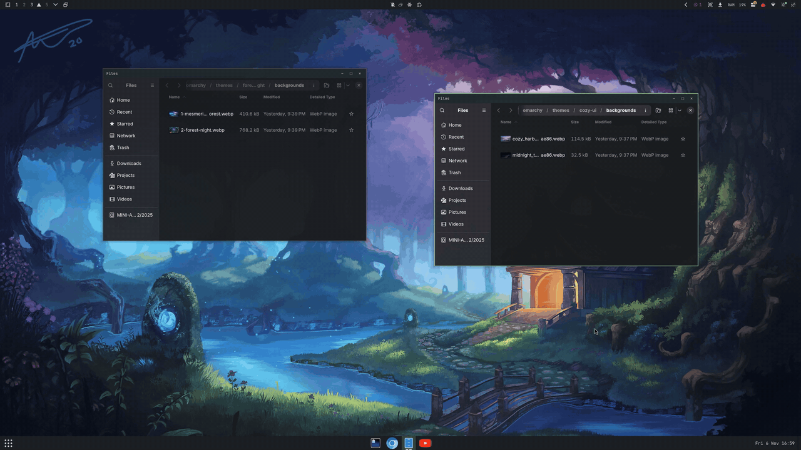
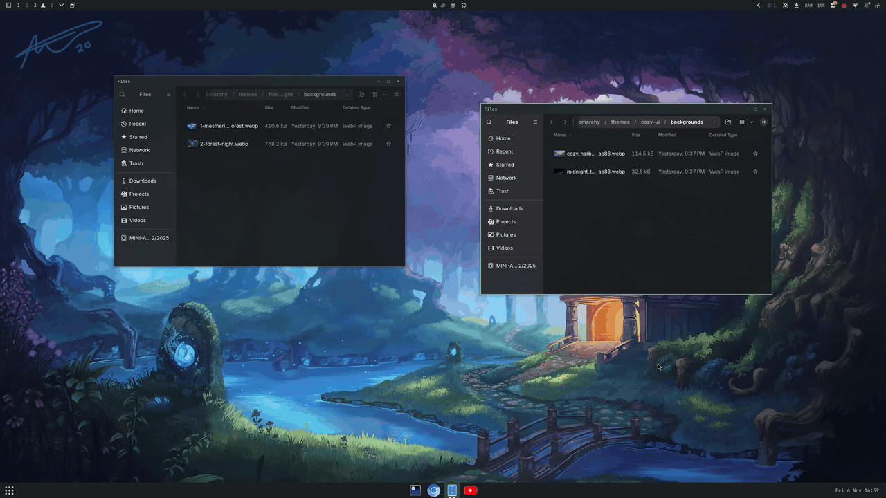

# Familiar Dock

**A Windows-style taskbar or a macOS-style dock for Omarchy.**



Familiar Dock puts a dock at the bottom of the screen like the one you left
behind on Windows or macOS. It shows your pinned and running apps, live
previews of their windows, an app drawer, the clock and Show Desktop. Choose
the **Windows** look for a full-width taskbar, or the **macOS** look for a
floating dock that magnifies under the pointer. One setting switches between
them.

It runs inside Omarchy's own shell, next to the top bar, and is inspired by
GNOME's [Dash to Panel](https://github.com/home-sweet-gnome/dash-to-panel),
whose setting names it keeps.

## Who it's for

- **People coming to Omarchy from Windows or macOS.** Omarchy's keyboard-first
  tiling is great, and sometimes you still want to see what's open and click
  it. Familiar Dock gives you the taskbar or dock you know, without giving up
  the keyboard.
- **Dash to Panel users from GNOME.** The settings use Dash to Panel's names
  and values, and its behaviors carry over: click to cycle windows, grouping,
  intellihide, the hover animations, Show Desktop.
- **Anyone who likes to tune their desktop.** Almost everything you see can be
  changed, and the Settings window makes that easy.

## Highlights

### Two familiar looks

- **Windows**: a full-width bar. Show Applications sits at the left, the apps
  in the middle, and the clock and Show Desktop at the right, with a dash
  under focused apps.
- **macOS**: a rounded, floating dock that fits its icons, with a light tint,
  a dot under each running app and a gentle macOS-style magnification.

Switch with **Look** at the top of Settings. Your pins, the panel's edge and
size, previews, menus and hotkeys stay as they are.

### Window previews

Hover over an app to see live thumbnails of its windows, with their titles.

- **Click** a preview to focus that window.
- **Middle-click** a preview to close it.
- **Rest the pointer** on a preview to *peek*: the other windows fade so you
  see just that one.

The preview size, delay, padding, aspect ratio, title style and opacity are
all settings, and previews can be turned off.

### Highly customisable

The Settings window has 170 settings:

- **Position**: put the panel on any edge, and set its size, length and anchor
  for each monitor; reorder or hide its elements.
- **Running-app marks**: dots, dashes, squares, segments and more, in colors
  picked from each app's icon or your own.
- **Hover**: Simple, Ripple, Plank or macOS-style magnification.
- **Intellihide**: the panel gets out of the way of windows and comes back at
  the screen edge.
- **Clicks and scrolling**: what a click, middle-click or scroll does on an
  app, on the panel and on the drawer icon.
- **Colors**: they follow your Omarchy theme, or use your own background,
  opacity and gradient.
- **The rest**: menus, badges and progress bars, and the tray.

Settings is built for the keyboard as well as the mouse. You can search every
setting by name or description, and a dot marks each changed one, with a
reset next to it. Press `c` to see only what you changed.



### At home in Omarchy

- **It keeps Omarchy's top bar** and moves the bar's clock and calendar into
  the panel.
- **It hides Omarchy's own dock** while it's enabled, and gives it back when
  you disable it.
- **Its colors follow the theme**, and it keeps text readable.
- **It has an app drawer**: a searchable grid of your apps, opened by its icon
  or a keybinding you choose.
- **It never edits your Hyprland files.** Its key binding lives only in the
  running compositor.


## Install

It needs Omarchy 4.5 with its Quickshell/Hyprland shell, plus `bash`, `jq`,
`flock` and Omarchy's usual launch commands. `dbus-monitor` is needed only for
the optional badges. It starts no second Quickshell process.

```sh
omarchy plugin add https://github.com/rugobal/omarchy-familiar-dock.git --enable
# Noninteractive installation may append --yes.
omarchy plugin update rugobal.familiar-dock
omarchy plugin validate ~/.config/omarchy/plugins/rugobal.familiar-dock
```

The CLI clones the repository into
`~/.config/omarchy/plugins/rugobal.familiar-dock`. It validates the manifest,
rescans and enables the plugin. Updates fetch, fast-forward, validate and
rescan. After an update that changes QML, run `omarchy restart shell`, since
a plain hot reload keeps the old components. You can also symlink a
development checkout into the plugins folder, but file watching doesn't follow
the symlink.

## Using it

Open **Settings** from the right-click menu of the panel or of the Show
Applications button. It opens on **Overview**: the look, the most-used
switches as tiles, and the panel's position, size, anchor, length and
background. The sidebar has Position, Style, Behavior, Action, Fine-Tune and
About. The panel stays visible while you edit.

- **Closing**: Escape, a click outside, the esc cap or the panel menu.
- **Saving**: each control saves only the key you change. Pins are edited on
  the panel itself.
- **Changes**: a changed setting shows a dot and a **(reset)** link, and the
  header counts them. **Reset all** asks first, keeps a backup with your pins,
  and restores the defaults (the Windows look).
- **About**: opens the JSON file, and exports or imports settings by path.

Clicking the header's count, or pressing `c`, shows only the settings you
changed:

- Each one stays on its own page, under its own heading, and you edit it as
  usual.
- The sidebar lists only the pages that have some, and how many each has.
- A setting you change meanwhile joins the list.
- A row you reset there stays, without its dot, until you leave the view, so
  nothing moves under the pointer.
- The search narrows the list further.

Escape, the esc cap or the pill's ✕ goes back to every setting, on the page
you were on.

The **Look** row reads the look back from the settings, so settings that match
neither look show **Custom**. When you leave Custom, it's saved in
`look-custom`, and picking Custom again brings it back. A look sets these, on
every monitor:

- the element layout, length and anchor;
- the margins, radius and background;
- the hover effect, highlights and running-app marks;
- intellihide.

The macOS look never hides.

**Keyboard in Settings:**

| Keys | Action |
| --- | --- |
| ↑ / ↓ (or j / k) | Move the cursor |
| ← / → (or h / l) | Change a value |
| Space or Enter | Toggle, open or edit |
| Backspace | Reset the row under the cursor |
| Ctrl+Backspace | Reset all |
| Alt+↑ / ↓ or Tab | Change page |
| `/` or Ctrl+F | Search |
| Home / End | Jump to the first or last row |
| `c` | Show only the changed settings |

In the search box, Enter goes to the results and Escape leaves it. In a text
or number field, Enter or Escape hands the keys back. The footer shows the
keys for the row under the cursor. The search matches names, descriptions,
group headings and page names, and the sidebar shows how many settings on each
page match.

**Menus and monitors:**

- **Menu entries** are Title/Command rows with add, remove and move controls.
  A command and its title save together.
- **Monitor options**: the Position page shows them only once a second monitor
  is connected.
  - **Apply changes to all monitors** chooses which monitors an edit goes to.
  - **Sync element positions** keeps the layouts in step afterwards.
- **The element editor** shows the five elements the panel draws, and keeps
  the GNOME-only elements in the file.

**Pins and dragging:**

- Drag an icon along the panel to reorder it, as in the top bar.
- A running app dropped ahead of a pin is pinned there.
- A running app dropped among the other running apps, including right after
  the last pin, only moves. It stays unpinned and keeps that place until the
  shell restarts, as in Dash to Panel.
- To cancel a drag, pull it well off the panel until its ghost shrinks, then
  let go. Escape can't cancel it, because the panel never takes keyboard
  focus.

**Hover animations:** Ripple and Plank follow the pointer, as in Dash to Panel,
and Plank spreads the icons apart. Unlike Dash to Panel, the gap it opens
belongs to the nearer icon, so the pointer always rests on an icon.
`animate-appicon-hover-macos` (Style tab, off by default) makes Plank behave
like the macOS Dock instead:

- the icons make exactly the room they grow by, so none overlap;
- a Show Apps button that touches the taskbar magnifies with them;
- a panel that fits its icons (length −1) widens as they grow.

Dash to Panel has no such option.

**Theme colors:** the background is chosen by sampling the pinned icons and
Show Apps. Samples are cached per theme and source. For colors picked
automatically, text contrast stays at least 4.5:1. Three settings change this:

- `theme-bg-color` picks a fixed theme role;
- `trans-use-custom-bg` uses your own colors;
- `icon-contrast-outline` adds a faint rim only to icons that fail the
  contrast check. It starts off.

**Scratchpad windows:** windows on Hyprland special workspaces, such as
Omarchy's scratchpad and drop-down console, stay off the taskbar unless
`show-scratchpad-windows` is on (Behavior tab). Minimized windows always
show.

**Top bar, dock and clock:** the panel sits alongside Omarchy's top bar.

- Before it hides an enabled Omarchy dock, it writes a marker saying the dock
  is its to give back.
- Before it removes the bar's clock entry, it saves the whole entry.
- A dock or clock you had already turned off yourself isn't claimed.
- Hiding the panel's clock gives the top bar its clock back right away.

### Settings file

Settings live in `~/.config/omarchy/familiar-dock.json` and apply without a
restart.

- **Defaults** come from the starter file `config/familiar-dock.seed.json`: the
  Windows look, 45 px, and three panel menu commands you can change. A
  missing file, **Reset all** and the "changed" marks all refer to that setup.
- **What the seed leaves out**: it has no custom desktop launchers, and leaves
  the favorites and theme colors to the system defaults.
- **Older defaults**: the taskbar at the left at 48 px, which reads as Custom,
  is kept in `config/dash-to-panel.defaults.json`. About › Import brings it
  back and keeps your pins.

Some rules about the file itself:

- **Monitors**: per-monitor maps use Hyprland names such as `DP-3`, with `"*"`
  for any other monitor.
- **Your own keys**: keys the plugin doesn't know survive its edits.
- **Bad JSON**: invalid JSON keeps the last valid settings.
- **Favorites**:
  - `favorites: null`, or no `favorites` key, follows your default browser,
    Files and terminal;
  - `[]` means no pins;
  - pinning or reordering writes the list out in full.

See [every setting and its limits](docs/settings-coverage.md), the
[full reference](docs/settings-reference.md) and the
[live fixtures](tests/settings/README.md).

### Off by default

Badges (`progress-show-count`, `progress-show-bar`), hotkeys and intellihide
start **off**. The defaults hide the right box, so no tray is built until you
show it, and badges are listened for only once a badge option is on.

- **Hotkeys** need [Lua bindings](docs/hotkeys.md) that you add yourself.
  `hot-keys: false` makes their IPC calls do nothing.
- **[Blur](docs/blur.md)** is a layer rule you add yourself.

The plugin never edits Hyprland files.

### Drawer keybinding

The **Drawer keybinding** (`show-apps-hotkey`, on Overview and the Position
tab) opens the app drawer, Show Applications. It starts as Omarchy's
Super+Alt+Space, which opens the app grid of the Omarchy dock the plugin
hides. The keybindings menu lists it as "Apps (Familiar Dock)".

**Changing it:**

1. Click the keys, or press Enter on the row.
2. Press the combination you want, such as Super+Tab.

Escape cancels, and Backspace turns the key off. While you record, Hyprland's
own bindings are paused in an empty submap, which Escape also leaves. So a
combination that's already taken reaches Settings instead of doing its
action.

**Where the binding lives:** only in the running compositor, set with
`hyprctl eval` as Omarchy's own shell does. The plugin applies it again after
each Hyprland reload.

**What it replaces:** an Omarchy default binding on that key, such as
Super+Tab's Next workspace. It leaves the key alone, and the row says why,
when:

- one of your own files under `~/.config/hypr` binds it;
- anything else is bound to it, in any submap;
- for Super+Alt+Space, Omarchy's default bindings are off.

Changing the key, turning it off, or disabling or removing the plugin reloads
Hyprland once. That brings back whatever your files configure.

### Drawer icon click

**Drawer icon click** (`show-apps-click`, next to the keybinding) sets what a
left click on the drawer icon does:

- open the app drawer (the default);
- open an app you pick;
- run a command;
- do what a keybinding does.

A keybinding is followed, not copied. At each click, the plugin lists the
key's bindings (`hyprctl binds`). It then runs the same functions Hyprland
runs when the key is pressed, inside Hyprland's own Lua state. So the icon
does whatever the key does now, even after you rebind it.

- **Left out:** bindings inside a submap, mouse bindings, and the plugin's own
  drawer key.
- **Press and release:** when a key has both, the click runs the press.
- **Nothing to run:** if the app you picked is no longer installed, or nothing
  is bound to the key, a click opens the drawer.
- **Failures:** a click that fails says so on the row.

When the icon does something else, right-clicking it offers "Open the app
drawer", and its tooltip says what a click does. Nothing in your Hyprland
files changes.

## IPC

IPC calls take the form `omarchy-shell rugobal.familiar-dock METHOD ARGS`.

- **Arguments**: every parameter is a string, and each method needs exactly
  the arguments listed.
- **Booleans**: setters accept true/false, 1/0, on/off and yes/no, in any case.
  An invalid value warns once and changes nothing.
- **Monitor**: an empty monitor means the focused panel.
- **Indices** count from zero, except `activateApp`, which counts from one.

| Method | Arguments | Example |
| --- | --- | --- |
| `showSettings` | tab | `omarchy-shell rugobal.familiar-dock showSettings "Style"` (`""` keeps the last tab) |
| `closeSettings` | none | `omarchy-shell rugobal.familiar-dock closeSettings` |
| `toggleSettings` | tab | `omarchy-shell rugobal.familiar-dock toggleSettings "About"` (`""` keeps the last tab) |
| `reloadConfig` | none | `omarchy-shell rugobal.familiar-dock reloadConfig` |
| `debugState` | none | `omarchy-shell rugobal.familiar-dock debugState` |
| `click` | monitor index left/middle/right modifiers | `omarchy-shell rugobal.familiar-dock click '' 0 left ctrl` |
| `clickElement` | monitor element button | `omarchy-shell rugobal.familiar-dock clickElement '' dateMenu left` |
| `scroll` | monitor index/panel delta | `omarchy-shell rugobal.familiar-dock scroll '' panel 120` |
| `hover` | monitor index/desktopButton/preview:n | `omarchy-shell rugobal.familiar-dock hover '' preview:0` |
| `unhover` | monitor | `omarchy-shell rugobal.familiar-dock unhover ''` |
| `menuItems` | none | `omarchy-shell rugobal.familiar-dock menuItems` |
| `menuActivate` | index | `omarchy-shell rugobal.familiar-dock menuActivate 1` |
| `activateApp` | n modifier (empty/shift/ctrl; kp: prefix for keypad) | `omarchy-shell rugobal.familiar-dock activateApp 1 ''` |
| `showOverlay` | none; hot-keys gate | `omarchy-shell rugobal.familiar-dock showOverlay` |
| `toggleIntellihide` | none; hot-keys gate | `omarchy-shell rugobal.familiar-dock toggleIntellihide` |
| `showDesktop` | none | `omarchy-shell rugobal.familiar-dock showDesktop` |
| `showApps` | none | `omarchy-shell rugobal.familiar-dock showApps` |
| `setClockVisible` | boolean string | `omarchy-shell rugobal.familiar-dock setClockVisible false` |
| `setThemeBgColor` | auto/bar/background/dark_background/darker_background/lighter_background | `omarchy-shell rugobal.familiar-dock setThemeBgColor auto` |
| `setIconContrastOutline` | boolean string | `omarchy-shell rugobal.familiar-dock setIconContrastOutline off` |

`clickElement` accepts showAppsButton, dateMenu, desktopButton or panel.
Modifiers are comma-separated shift/ctrl, or `''`. These hooks use the real
input paths. `omarchy-shell shell toggle rugobal.familiar-dock` opens the same
app grid.

`debugState` reports:

- the panels with their items, windows and popups;
- which monitor answers clock IPC, and any pending handoff;
- the clock's source (hidden, Omarchy or fallback) and whether the plugin owns
  the bar's clock;
- where the defaults come from;
- the background role and its scores, and the outlined icons;
- faded windows and intellihide state;
- the overlay, the tray count and dynamic opacity;
- per-app badges and whether their listener runs.

## Disable or uninstall

If you're testing from this checkout, restore your settings fixture first:

```sh
tools/try-settings.sh restore  # only if testing from this checkout
omarchy plugin disable rugobal.familiar-dock
# Or remove it; remove disables a running plugin before deleting it:
omarchy plugin remove rugobal.familiar-dock
```

Three seconds later, a detached script gives back the dock and clock the
plugin took and restores each window's opacity. It then removes
`~/.local/state/familiar-dock/`. The script carries everything it needs, so
deleting the plugin folder can't break it. Only your settings JSON remains.

The cleanup errs on the side of keeping evidence:

- a running settings test keeps its backup and marker;
- a restore that fails leaves its recovery files instead of deleting them.

A shell that is killed or stopped never runs this cleanup, so it can leave the
dock or clock hidden and stale files behind; the Omarchy CLI has no uninstall
hook outside the running shell. To recover, keep
`~/.local/state/familiar-dock/`, enable the plugin again, let it start, then
disable it with the shell running: its cleanup restores the dock, the clock
and window opacity from those files.

## Known limits

- **GNOME-only features**: Activities, the System menu, the overview and the
  legacy options do nothing. Edge pressure is replaced by edge dwell.
- **Windows**:
  - Hyprland has no minimize, so it uses Omarchy's special workspace and tag
    convention.
  - Spread uses previews.
  - Peek can't bring a window from another workspace into view.
- **Icons and previews**: symbolic icons depend on your icon theme, and
  previews of minimized windows need compositor support.
- **Radius**: the global radius applies only to this plugin.
- **Layout boxes**: leftBox and centerBox are empty compatibility containers,
  so leftBox sizing has nothing to affect. The settings editor doesn't list
  them, and unlike Dash to Panel the layout ignores them too, so a box you
  can't see never splits or moves the elements around it.
- **Top bar**: `stockgs-keep-top-panel: false` can't turn this plugin into a
  replacement for the top bar.
- **Badges**: Unity signals are optional and depend on the app. Omarchy's
  notification service gives no per-app counts.
- **Tray menus**: native tray menus need QApplication, so this shell draws its
  own popup for `QsMenuAnchor`/`QsMenuOpener` handles, submenus included.
- **Accelerators**: physical accelerator settings can't install Lua bindings.
  The base chord already includes Ctrl, so a separate Ctrl action needs a
  chord you check first.

The [coverage table](docs/settings-coverage.md) gives the exact reason for
each key.

## Development

Verify with `node tests/run.mjs` and `omarchy plugin validate "$PWD"`.

- **Isolation**: the tests use private HOME directories inside the repository,
  and mocked compositor and CLI commands.
- **Settings check**: it needs Qt 6 QtTest (`qmltestrunner`) and Omarchy's
  installed `qs.Ui` sources. It builds the controls offscreen with fixed theme
  tokens.
- **No live rendering**: the tests don't check what the compositor draws.
  Check visual changes live after `omarchy restart shell`, since a hot reload
  keeps the old QML.

## Credits and license

Familiar Dock began as a port of GNOME's
[Dash to Panel](https://github.com/home-sweet-gnome/dash-to-panel) and owes it
the setting names, the defaults, the layout and much of the click and window
behavior. Thank you to its authors and contributors.

Copyright (C) 2026 Ruben Gomez. Licensed GPL-2.0-or-later, like Dash to Panel;
see [LICENSE](LICENSE).
[NOTICE.md](NOTICE.md) records the upstream sources. It also keeps the MIT
notices for the app grid adapted from Omarchy and for the settings window
modeled on OmaControl.
